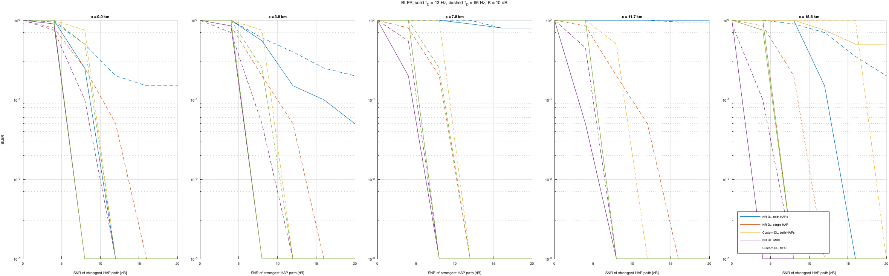
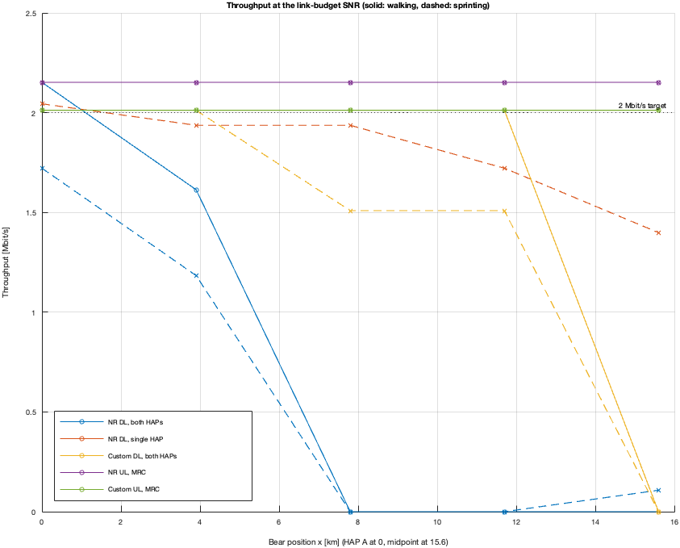
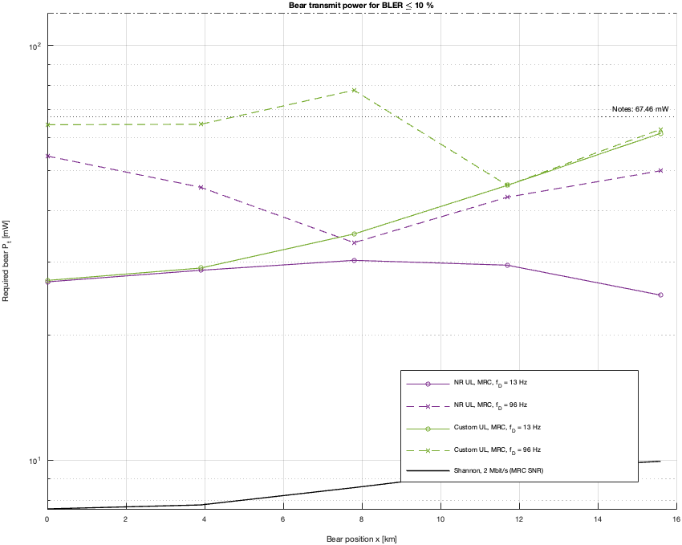
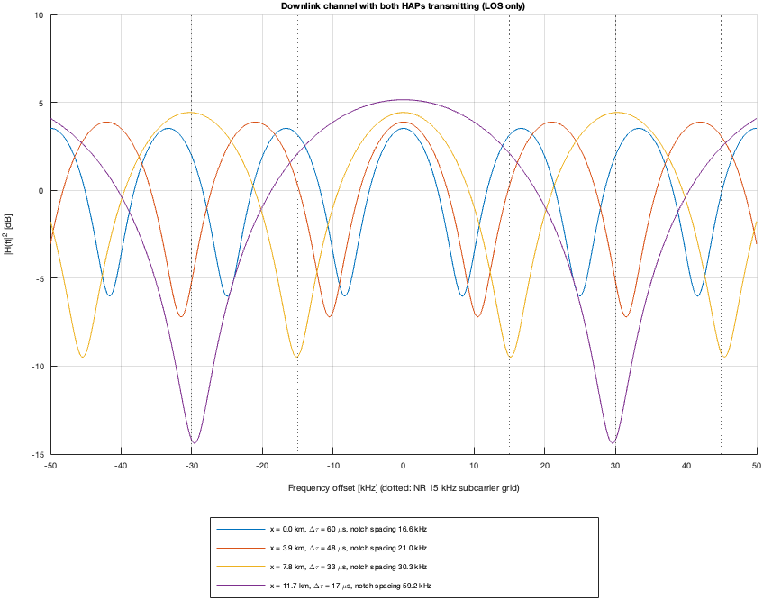

# Two-HAP Svalbard link simulation (5G NR vs. custom narrowband OFDM)

MATLAB simulation of a polar-bear research link on Svalbard. Two high-altitude platform stations (HAPs, Airbus Zephyr class, 18 km altitude) cover a bear on the ground at 2 GHz. The bear needs about **2 Mbit/s uplink** for HD video, and the HAPs send data back on the downlink.

The simulation compares two physical layers over the same channel:

| | 5G NR (standard) | Custom narrowband OFDM |
|---|---|---|
| Subcarrier spacing | 15 kHz | 1 kHz |
| Cyclic prefix | about 4.7 µs | 116 µs |
| Modulation | 16QAM | 8PSK |
| Coding | 5G LDPC, rate 378/1024 | 5G LDPC, rate 1/2, random bit interleaver |
| Peak rate | 2.15 Mbit/s | 2.01 Mbit/s |

The channel is two paths (one per HAP) with different delays, path losses, carrier phases and Doppler. The delay difference reaches **60 µs** when the bear is below one HAP, which is far longer than the NR cyclic prefix. The comparison shows what that does to a standard 5G waveform and how a narrowband design with a long CP copes.

All numbers (altitude, antenna, powers, losses, noise, Doppler) come from the course notes and are collected in [`hapParams.m`](hapParams.m).

## Requirements

- **MATLAB R2024a** (tested). Newer releases should work.
- **5G Toolbox**
- **Communications Toolbox**

Installing them adds the toolboxes they depend on (DSP System Toolbox and Signal Processing Toolbox).

Install the toolboxes in MATLAB via **Home → Add-Ons → Get Add-Ons**, search for the name and click *Install*. A university or company license normally covers them. Check with:

```matlab
ver   % should list "5G Toolbox" and "Communications Toolbox"
```

`checkLinkBudget.m` uses base MATLAB only, so it runs without any toolbox.

## Running

```matlab
checkLinkBudget   % no toolboxes needed, checks the model against the notes
runAll            % full simulation, shows 4 figures and saves them to figures/
```

`runAll.m` starts with `quick = true`, a fast smoke test (about 3 minutes, 20 NR slots or 4 custom frames per point), so the BLER curves are coarse. Set `quick = false` at the top of the file for the full run (300 slots, 40 frames per point, which takes much longer).

From a terminal (the Intel build of MATLAB on an Apple-silicon Mac needs the `arch` prefix):

```bash
arch -x86_64 /Applications/MATLAB_R2024a.app/bin/matlab -batch "runAll"
```

## Files

| File | Purpose |
|---|---|
| `hapParams.m` | All system parameters, one struct |
| `hapGeometry.m` | Slant ranges, angles from nadir, delays and delay difference |
| `hapAntennaGain.m` | HAP antenna pattern (-3 dB at 60° from nadir) |
| `linkBudget.m` | Free-space loss, fixed losses, SNR, C/I and Shannon capacity |
| `makeHapChannel.m`, `applyHapChannel.m` | Two-path Rician channel from `nrTDLChannel`, with the carrier phase, delay, Doppler and slow scintillation |
| `nrLinkSim.m` | Shared 5G NR chain (PUSCH/PDSCH with DM-RS channel estimation, MMSE equalisation, LDPC decoding) |
| `nrUplinkSim.m`, `nrDownlinkSim.m` | Wrappers for the uplink and downlink |
| `customOfdmSim.m` | The 1 kHz, 8PSK, rate-1/2 design |
| `runAll.m` | Sweeps and plots |
| `checkLinkBudget.m` | Checks against the numbers in the notes |

## Systems and terms

Five systems are simulated, plotted with the same colours in every figure:

- **NR DL, both HAPs**: both HAPs send the same 5G NR signal, so the bear sees the sum of two delayed copies.
- **NR DL, single HAP**: only the stronger HAP sends the signal.
- **Custom DL, both HAPs**: the narrowband design with both HAPs sending.
- **NR UL, MRC** and **Custom UL, MRC**: the bear sends and both HAPs receive. The two receptions are combined by maximum-ratio combining (MRC), which assumes a link between the HAPs.

**Bear position x** is the distance along the line between the HAPs. x = 0 km is directly under HAP A, and x = 15.6 km is the midpoint (the HAPs are 31.2 km apart). **BLER** is the block error rate (the fraction of transport blocks that fail the CRC). **f_D** is the maximum Doppler shift: 13 Hz is a walking bear and 96 Hz a sprinting bear. **K** is the Rician K-factor, the power ratio of the direct path to ground reflections (assumed 10 dB).

## What the plots show

### `figures/bler_vs_snr.png`: BLER vs SNR



One panel per bear position (0, 3.9, 7.8, 11.7 and 15.6 km). Each curve is the block error rate against the SNR of the strongest HAP path. Solid lines are walking (13 Hz) and dashed lines are sprinting (96 Hz). A curve that drops steeply to the bottom is a link that works once there is enough SNR. A curve that **flattens out** is an **error floor**: more power does not help because the errors come from interference between the two paths and not from noise.

Read it as follows. If a system's curve reaches low BLER at an SNR below what the link budget gives at that position (about 7 to 11 dB), the system works there. The "NR DL, both HAPs" curves flatten at x = 7.8 and 11.7 km because the 17 to 33 µs echo falls outside the 4.7 µs cyclic prefix and causes inter-symbol interference.

### `figures/throughput_at_operating_point.png`: throughput vs position



For every bear position the SNR is taken from the link budget (the operating SNR of the strongest HAP), and the simulation gives the average throughput as peak rate × (1 - BLER). The dotted line is the 2 Mbit/s target. Solid lines are walking and dashed lines sprinting. This is the figure to look at for the practical answer: which design delivers the video rate where.

### `figures/required_bear_power.png`: bear transmit power for BLER ≤ 10 %



For the uplink only. For each bear position it shows the transmit power the bear needs so that BLER drops to 10 %, found by interpolating the BLER curves and shifting by the link budget. The black line is the Shannon limit for 2 Mbit/s with combined reception. The dotted line is the 67.46 mW from the notes and the dash-dotted line at the top is the 120 mW assumed transmit power. A curve below the 120 mW line means the link has margin. The gap between a curve and the Shannon line is the cost of a practical receiver (coding, channel estimation, Doppler). The curves are coarse in the quick run because BLER is only sampled every 4 dB.

### `figures/downlink_frequency_response.png`: two-path downlink channel



The frequency response |H(f)|² of the downlink when both HAPs send the same signal (direct paths only, no fading), for four bear positions. The two paths add and cancel across frequency and give **notches**, spaced 1/Δτ apart: for example 16.6 kHz for Δτ = 60 µs, and 59.2 kHz for Δτ = 17 µs. The dotted vertical lines are the 15 kHz NR subcarrier grid. NR subcarriers are as wide as the notch spacing and so see strongly different gains within one symbol, while 1 kHz subcarriers are much narrower than the notches and see an almost flat gain each. This is the reason for the narrowband design.

## Model assumptions

These values are **not** in the course notes and can be changed in `hapParams.m`:

- Rician K-factor of each HAP path: 10 dB.
- HAP spacing: 31.2 km, which is what the delay-spread tables in the notes imply. The interference section of the notes uses 50 km. Change `p.dHAP` to switch.
- Bear antenna gain: 0 dBi.

Simplifications:

- No HARQ retransmissions. BLER is the first-transmission block error rate.
- The custom receiver has perfect timing and knows the noise level. The NR receiver estimates both.
- Each (position, SNR) point uses one fixed channel realisation, so results are not averaged over random channels.
- Doppler from the HAPs' own motion is not modelled.
- The bear's local multipath is a single Rician tap per HAP, not a full scattering model.
- Rain, gas absorption and scintillation are fixed margins from ITU-R P.618 and P.676 (scintillation also adds a small random gain per slot).

## Results

The figures in `figures/` come from the quick run. For report-quality numbers, run with `quick = false` and ideally average over several channel seeds.

## Uplink plots

The bear-to-HAP uplink ("NR UL, MRC" and "Custom UL, MRC" in the legends) appears in three of the four figures above:

- **`figures/bler_vs_snr.png`**: the uplink BLER curves, combined by MRC across both HAPs, alongside the downlink curves in the same panels.
- **`figures/throughput_at_operating_point.png`**: uplink throughput vs. bear position, against the 2 Mbit/s video target.
- **`figures/required_bear_power.png`**: uplink only — the bear transmit power needed for BLER ≤ 10 % at each position, compared against the Shannon limit, the 67.46 mW link-budget figure from the notes, and the assumed 120 mW transmit power.

The downlink frequency response plot (`figures/downlink_frequency_response.png`) is downlink-only and not part of the uplink results.
